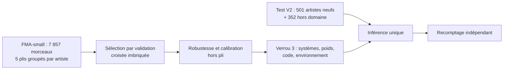

# Classification des genres musicaux : ViT, encodeurs audio préentraînés et réplication préenregistrée

Ce projet classe des extraits de 30 s de la [Free Music Archive](https://github.com/mdeff/fma) en 8 genres. Il s'est fait en deux temps :

- **V1, sur FMA-small.** Un ViT d'images gelé, appliqué à des spectrogrammes (bloc 6, entrée HPSS), battait le ViT d'origine.
- **V2, réplication préenregistrée.** La conclusion de la V1 est remise à l'épreuve sur un test neuf : 501 artistes absents de FMA-small. Ce test n'est évalué **qu'une seule fois**, après le gel des systèmes par empreintes. La V2 compare aussi des encodeurs audio préentraînés.

## Résultats principaux

Test V2 : 501 morceaux, un par artiste. Macro-F1 au niveau du morceau ; intervalles de confiance BCa à 95 % (5 000 tirages).

| Système | Macro-F1 | IC 95 % | Accuracy |
|---|---:|---:|---:|
| **MAEST bloc 12 gelé + sonde logistique** | **0,572** | [0,534 ; 0,615] | 57,9 % |
| ViT d'images bloc 6 + HPSS (candidat V1) | 0,481 | [0,442 ; 0,525] | 49,1 % |
| ViT d'images bloc 6 | 0,477 | [0,441 ; 0,523] | 48,7 % |
| ViT d'images bloc 12 | 0,453 | [0,418 ; 0,496] | 46,9 % |
| CNN renforcé (3 graines) | 0,444–0,462 | — | 45,9–47,9 % |

| Hypothèse préenregistrée | Différence | IC 95 % | Conclusion |
|---|---:|---:|---|
| H1 (primaire) : réplication du gain V1 (bloc 6 + HPSS − ViT) | +0,028 | [−0,007 ; +0,064] | Non concluante (p = 0,12 ; puissance ≈ 56 %) |
| H2 : MAEST − candidat V1 | +0,091 | [+0,049 ; +0,134] | Confirmée (p Holm = 0,0003) |
| H3 : MAEST − CNN renforcé | +0,117 | [+0,083 ; +0,154] | Confirmée (p Holm = 0,0003) |

**Ce qu'il faut retenir**

- **Un encodeur audio préentraîné gelé (MAEST) fait nettement mieux** que le ViT d'images et qu'un CNN entraîné de zéro.
- **Le gain de la V1 se retrouve dans le même sens** sur le test neuf, mais il n'y est plus significatif.
- **La validation croisée surestime la performance d'environ 11 points** sur de nouveaux artistes, même groupée par artiste. Sur le test, Instrumental et Electronic sont souvent classés Experimental.
- **La calibration et le rejet ne se transfèrent pas** du développement au test : l'ECE se dégrade, et 89 % des morceaux de genres inconnus sont acceptés.

Le [rapport V2](docs/RAPPORT_V2.md) présente toutes les analyses, y compris les défavorables.

## Méthode



- **Protocole préenregistré** avant le téléchargement des données de test ([PROTOCOLE_V2.md](docs/PROTOCOLE_V2.md)).
- **Trois verrous par empreintes SHA-256** ([reports/v2/](reports/v2/)). Le script d'évaluation refuse de tourner si un fichier ou un paquet épinglé a changé.
- **Classification** : sonde logistique sur les représentations gelées de trois fenêtres de 10 s, puis moyenne des probabilités par morceau.
- **Comparateurs** :
  - AST et PANNs CNN14 ;
  - MAEST ;
  - ViT d'images, redimensionné, à résolution native ou affiné ;
  - descripteurs musicaux ;
  - CNN renforcé.

## Documentation

| Document | Contenu |
|---|---|
| [Rapport V2](docs/RAPPORT_V2.md) | Question, protocole, résultats, conclusions, limites |
| [Fiche des données](docs/FICHE_DONNEES.md) | Cohortes, audit, licences, écarts connus |
| [Fiche du modèle V2](docs/FICHE_MODELE_V2.md) | Fonctionnement, performances, usages, limites |
| [Interprétation](docs/INTERPRETATION_V2.md) | Écart de la V1, analyse par artiste et par genre, écoute des erreurs |
| [Architecture](docs/ARCHITECTURE.md) | Modules, traçabilité, verrous |
| [Reproduction](docs/REPRODUCTION.md) | Installation vérifiée, données, poids, chaîne de commandes |
| [Contrôle final](docs/CONTROLE_FINAL.md) | Critiques de la V1 et traitement de chacune |
| [Plan V2](docs/PLAN_V2.md) | Déroulé des phases et décisions datées |

**Historique de la V1**

- L'étiquette Git `v1-final` fige la V1 livrée.
- Les documents de la V1 sont dans [docs/archive/](docs/archive/), et son évaluation finale dans [reports/EVALUATION_FINALE.md](reports/EVALUATION_FINALE.md).
- Quelques documents de la V1 restent à leur place d'origine (fiche du modèle V1, conclusion V1, notebooks), car des fichiers de preuve les épinglent par chemin et par empreinte.

## Démarrage rapide

Il faut Python 3.13 et [`uv`](https://github.com/astral-sh/uv). Les versions des dépendances sont figées dans `requirements/`.

```powershell
uv venv --python 3.13 .venv
uv pip install --python .venv\Scripts\python.exe --torch-backend cpu -r requirements/windows-cpu-py313.txt
uv pip install --python .venv\Scripts\python.exe --no-deps -e .
.\.venv\Scripts\python.exe -m pytest -q
```

Sans les données, les poids et les exports locaux, les tests qui en ont besoin sont **ignorés**, avec leur raison affichée. Pour obtenir ces éléments, voir [REPRODUCTION.md](docs/REPRODUCTION.md).

Recalculer tous les chiffres du test V2 à partir des prédictions archivées :

```powershell
.\.venv\Scripts\python.exe scripts/recount_v2.py --evaluation reports/v2/final_evaluation
```

## Organisation

```text
src/music_genre/    audio, données, caractéristiques, modèles, entraînement, évaluation, inférence
scripts/            chaîne V2 (extraction, CV, robustesse, évaluation unique, recomptage) et outils V1
configs/            une configuration par représentation et par étape ; protocole V2
reports/            rapports et preuves ; reports/v2/ : verrous et évaluation finale
docs/               documentation ci-dessus ; docs/archive/ : historique V1
notebooks/          notebooks pédagogiques de la V1, avec leurs exports HTML
app/                démonstration Gradio locale (V1)
tests/              tests unitaires et de contrats
```

`data/`, `runs/` et `artifacts/pretrained/` sont locaux et ne sont jamais versionnés. Certains rapports de la V1 renvoient vers ces dossiers : leurs liens ne fonctionnent qu'après reproduction.

## Données, poids et licences

- **Code** : licence [MIT](LICENSE).
- **Audio FMA** : non inclus. Chaque morceau a sa propre licence Creative Commons, non commerciale pour 82 à 87 % d'entre eux.
- **Poids préentraînés** : non inclus. Ils se téléchargent avec leurs empreintes.

| Poids | Licence |
|---|---|
| MAEST | CC-BY-NC-SA-4.0, non commercial |
| AST | BSD-3-Clause |
| PANNs | CC-BY-4.0 |
| ViT tiny | Apache-2.0 |

Le modèle V2 repose sur MAEST : il hérite donc de sa restriction non commerciale.

## Limites

- Un seul test indépendant, avec une puissance modeste pour H1.
- Les étiquettes de FMA n'ont pas été vérifiées.
- La robustesse n'est mesurée que sur des dégradations synthétiques.
- On ne peut pas vérifier si les données de préentraînement de MAEST recoupent FMA.
- Tout a tourné sur CPU seul, avec un Python x86-64 émulé sur Windows ARM64.

Le détail est dans la [fiche du modèle](docs/FICHE_MODELE_V2.md) et le [rapport](docs/RAPPORT_V2.md).

## Citer

Voir [CITATION.cff](CITATION.cff).
