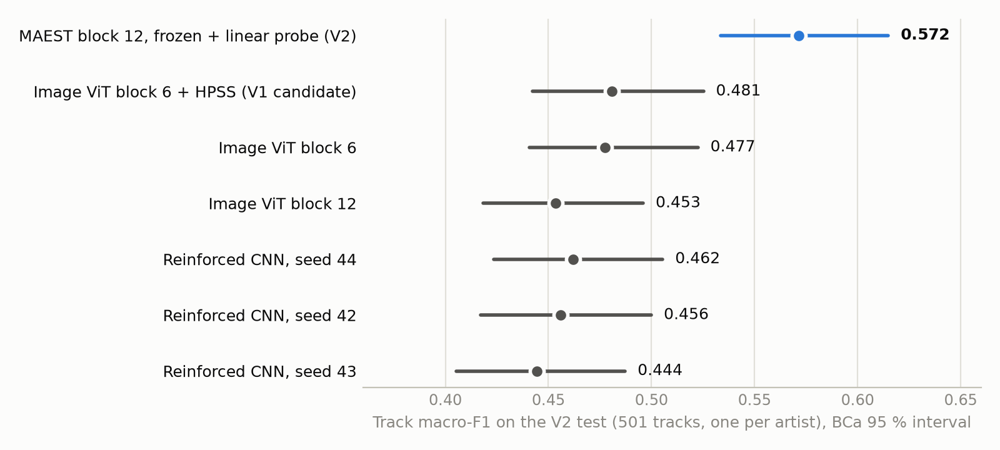
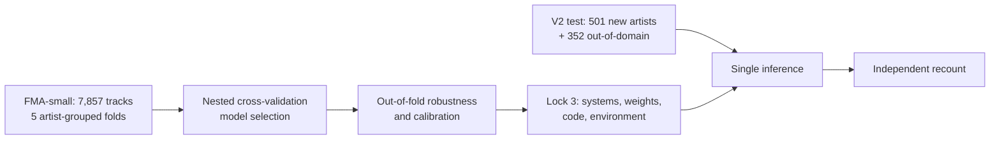

# Music genre classification — image ViTs, pretrained audio encoders and a preregistered replication

*[Version française plus bas](#version-française)*

Eight-genre classification of 30-second clips from the [Free Music Archive](https://github.com/mdeff/fma), in two stages.

- **V1 (FMA-small).** A frozen image Vision Transformer applied to spectrograms (block 6, HPSS input) beat the original ViT.
- **V2 (preregistered replication).**
  - **Goal**: put that claim to a new test of 501 artists absent from FMA-small.
  - **Rule**: that test is scored **exactly once**, after every system, weight, line of code and package version is frozen by SHA-256 hashes.
  - **Comparison**: V2 also compares pretrained audio encoders.



## Highlights

| Preregistered hypothesis | Macro-F1 difference | BCa 95 % CI | Outcome |
|---|---:|---:|---|
| H1 (primary): V1 gain replicates (ViT block 6 + HPSS − ViT) | +0.028 | [−0.007, +0.064] | Inconclusive (p = 0.12, power ≈ 56 %) |
| H2: MAEST − V1 candidate | +0.091 | [+0.049, +0.134] | Supported (Holm p = 0.0003) |
| H3: MAEST − reinforced CNN (3 seeds) | +0.117 | [+0.083, +0.154] | Supported (Holm p = 0.0003) |

- **A frozen pretrained audio encoder wins clearly.** MAEST reaches a track macro-F1 of **0.572** [0.534, 0.615], against 0.481 for the best V1 system and 0.444–0.462 for a CNN trained from scratch.
- **The V1 gain keeps its sign but is no longer significant** on a fresh test. The V1 validation-to-test drop of 9 points comes from how artists are spread across the splits, not from selection overfitting: heads that were never selected on the V1 validation set reproduce it.
- **Artist-grouped cross-validation still overestimates performance on new artists by about 11 points.** Instrumental and Electronic tracks drift towards Experimental.
- **Calibration and rejection tuned on the development set do not transfer.** Test ECE rises from 0.045 to 0.085, and 89 % of out-of-domain tracks are accepted. These unfavourable results are reported as such.

## Method



- **Preregistration.** The protocol was written before the test audio was downloaded ([PROTOCOLE_V2.md](docs/PROTOCOLE_V2.md)).
- **Three hash locks** ([reports/v2/](reports/v2/)). The evaluation script refuses to run if any pinned file or package changed.
- **Pipeline.** Frozen representations of three 10-second windows feed a logistic probe; window probabilities are averaged per track.
- **Statistics.** BCa intervals (5,000 resamples), Holm correction for the secondary hypotheses, and an independent recount with scikit-learn and SciPy.
- **Systems compared.**
  - pretrained audio encoders: AST, PANNs CNN14, MAEST;
  - image ViT, resized, at native resolution or fine-tuned;
  - handcrafted musical descriptors;
  - reinforced CNN.

## Documentation (in French)

| Document | Content |
|---|---|
| [Rapport V2](docs/RAPPORT_V2.md) | Question, protocol, results, conclusions, limits |
| [Fiche des données](docs/FICHE_DONNEES.md) | Cohorts, audit, licences, known shifts |
| [Fiche du modèle V2](docs/FICHE_MODELE_V2.md) | Model card: how it works, performance, intended use, limits |
| [Interprétation](docs/INTERPRETATION_V2.md) | V1 gap, per-artist and per-genre analysis, listening review |
| [Architecture](docs/ARCHITECTURE.md) | Modules, traceability, locks |
| [Reproduction](docs/REPRODUCTION.md) | Verified installation, data, weights, command chain |
| [Contrôle final](docs/CONTROLE_FINAL.md) | Each criticism of V1 and how it was handled |

The V1 is tagged `v1-final`. Its documents are in [docs/archive/](docs/archive/), and its final evaluation is in [reports/EVALUATION_FINALE.md](reports/EVALUATION_FINALE.md).

## Quick start

You need Python 3.13 and [`uv`](https://github.com/astral-sh/uv). Exact versions are pinned in `requirements/`.

```powershell
uv venv --python 3.13 .venv
uv pip install --python .venv\Scripts\python.exe --torch-backend cpu -r requirements/windows-cpu-py313.txt
uv pip install --python .venv\Scripts\python.exe --no-deps -e .
.\.venv\Scripts\python.exe -m pytest -q
.\.venv\Scripts\python.exe scripts/recount_v2.py --evaluation reports/v2/final_evaluation
```

Without the local data, weights and exports, the tests that need them are **skipped**, and the reason is shown. The last command recomputes every V2 test figure from the archived predictions.

## Repository layout

| Path | Content |
|---|---|
| `src/music_genre/` | Audio, data, features, models, training, evaluation, inference |
| `scripts/` | V2 pipeline (extraction, CV, robustness, single evaluation, recount, figures) and V1 tools |
| `configs/` | One configuration per representation and per step; V2 protocol |
| `reports/` | Reports and evidence; `reports/v2/` holds the locks and the final evaluation |
| `docs/` | Documentation; `docs/archive/` holds the V1 history |
| `notebooks/`, `app/` | V1 teaching notebooks (with HTML exports) and local Gradio demo |
| `tests/` | Unit and contract tests |

`data/`, `runs/` and `artifacts/pretrained/` are local and never versioned. Some V1 reports link to them, so those links only resolve after reproduction.

## Data, weights and licences

| Item | Licence | In this repository |
|---|---|---|
| Code | [MIT](LICENSE) | Yes |
| FMA audio | Per-track Creative Commons, 82–87 % non-commercial | No |
| MAEST weights | CC-BY-NC-SA-4.0, non-commercial | No |
| AST weights | BSD-3-Clause | No |
| PANNs weights | CC-BY-4.0 | No |
| ViT tiny weights | Apache-2.0 | No |

Weights are downloaded with their hashes. The V2 model inherits MAEST's non-commercial restriction.

## Limitations

- One independent test set, and modest power for H1.
- FMA labels are not verified.
- Robustness is measured on synthetic degradations only.
- MAEST's pretraining data may overlap with FMA; this cannot be checked.
- Everything ran CPU-only, on emulated x86-64 Python under Windows ARM64.

## Citation

See [CITATION.cff](CITATION.cff).

---

## Version française

Classification de 8 genres sur des extraits de 30 s de la [Free Music Archive](https://github.com/mdeff/fma), en deux temps.

- **V1 (FMA-small).** Un ViT d'images gelé, appliqué à des spectrogrammes (bloc 6, entrée HPSS), battait le ViT d'origine.
- **V2 (réplication préenregistrée).**
  - **Objectif** : soumettre cette conclusion à un test neuf de 501 artistes absents de FMA-small.
  - **Règle** : ce test n'est évalué **qu'une seule fois**, après le gel de chaque système, poids, ligne de code et version de paquet par empreintes SHA-256.
  - **Comparaison** : la V2 compare aussi des encodeurs audio préentraînés.

### Résultats principaux

| Hypothèse préenregistrée | Différence de macro-F1 | IC 95 % (BCa) | Conclusion |
|---|---:|---:|---|
| H1 (primaire) : réplication du gain V1 (bloc 6 + HPSS − ViT) | +0,028 | [−0,007 ; +0,064] | Non concluante (p = 0,12, puissance ≈ 56 %) |
| H2 : MAEST − candidat V1 | +0,091 | [+0,049 ; +0,134] | Confirmée (p Holm = 0,0003) |
| H3 : MAEST − CNN renforcé (3 graines) | +0,117 | [+0,083 ; +0,154] | Confirmée (p Holm = 0,0003) |

- **Un encodeur audio préentraîné gelé l'emporte nettement.** MAEST atteint **0,572** [0,534 ; 0,615], contre 0,481 pour le meilleur système V1 et 0,444–0,462 pour un CNN entraîné de zéro.
- **Le gain de la V1 garde son sens, mais n'est plus significatif** sur le test neuf. Sa baisse de 9 points entre validation et test venait de la répartition des artistes, pas d'un surapprentissage de la sélection.
- **La validation croisée surestime d'environ 11 points** la performance sur de nouveaux artistes, même groupée par artiste. Instrumental et Electronic basculent vers Experimental.
- **La calibration et le rejet ne se transfèrent pas** : l'ECE passe de 0,045 à 0,085, et 89 % des morceaux hors domaine sont acceptés.

### Documentation, reproduction et licences

- **Documentation** : le [rapport V2](docs/RAPPORT_V2.md) est le point d'entrée. Les autres documents sont listés dans le tableau en anglais ci-dessus.
- **Installation** : voir [REPRODUCTION.md](docs/REPRODUCTION.md).
- **Licences** :
  - code : MIT ;
  - audio FMA et poids préentraînés : non inclus ;
  - MAEST : licence non commerciale.
- **Limites** : un seul test indépendant ; étiquettes FMA non vérifiées ; dégradations synthétiques ; recouvrement possible entre les données de préentraînement de MAEST et FMA ; calcul sur CPU seul.
