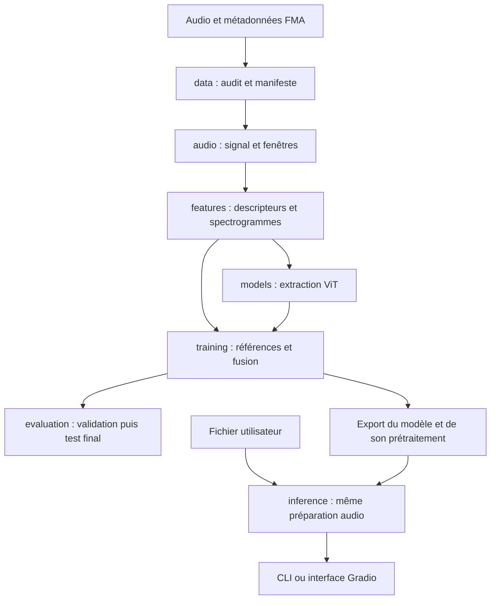

# Architecture du projet

État au 20 octobre 2026 : structure créée, diagnostic exécutable, modules métier réservés. Les responsabilités ci-dessous décrivent la cible ; elles ne signifient pas que le pipeline est implémenté.

## 1. Organisation retenue

Un package Python unique, `music_genre`, regroupe le code réutilisable. CLI, notebooks et Gradio l’appelleront. Pas de services distribués, de base de données applicative ou d’API web séparée pour cette version.

L’extraction d’embeddings est pilotée par `features` avec un adaptateur dans `models`. Ce diagramme représente le flux des données, pas des imports circulaires.

## 2. Responsabilités

| Module | Responsable de | Ne doit pas faire |
|---|---|---|
| data | Acquisition future, métadonnées, audit, partitions, manifeste | Décider des classes à partir du nom d’un fichier |
| audio | Lire le signal, rééchantillonner, segmenter et conserver les temps valides | Ajuster une normalisation statistique du dataset |
| features | Calculer les descripteurs, préparer les entrées, extraire/cacher les embeddings, aligner la fusion | Ajuster des paramètres sur validation/test |
| models | Construire les références et encapsuler les checkpoints | Télécharger des poids implicitement à l’import du package |
| training | Ajuster scalers/classificateurs, sélectionner sur validation, sauvegarder/reprendre | Sélectionner avec les scores du test |
| evaluation | Agréger par morceau, calculer métriques, incertitudes et robustesse | Réentraîner un modèle |
| inference | Charger un export complet et produire une prédiction traçable | Accéder au corpus d’entraînement |
| app | Présenter les résultats et gérer l’interaction | Dupliquer la logique audio ou apprendre un scaler |

Les bibliothèques lourdes seront chargées seulement dans les parcours qui en ont besoin. `doctor` doit fonctionner sans PyTorch, librosa ou Gradio.

## 3. Traçabilité de bout en bout

Le [contrat de données](CONTRATS.md) fixe les identifiants qui relient morceaux, fenêtres, caractéristiques et prédictions. Un cache utilisera une clé dérivée de la source, du prétraitement, du modèle, de sa couche et de ses statistiques de normalisation. Un simple nom de fichier ne suffit pas.

Chaque exécution conservera sa configuration résolue. L’ordre des classes est unique, dans `configs/labels.json`, puis copié dans l’export. Les références à des fichiers d’une autre expérience doivent porter une empreinte.

Les originaux restent dans `data/raw`. Les caches sont recréables. Les checkpoints permettent la reprise ; l’export contient uniquement ce qui est nécessaire pour la prédiction et sa provenance. Les rapports publics sont sélectionnés explicitement.

## 4. Configuration et environnement

`configs/reference.toml` est une description initiale du protocole ViT, pas un pipeline déjà opérationnel. Les paramètres audio encore ouverts sont explicitement signalés. La lecture TOML utilisera la bibliothèque standard ; le choix d’un framework de configuration n’est pas nécessaire.

`pyproject.toml` sépare le socle des dépendances audio, ML, démo et notebooks. Les versions exactes seront verrouillées après validation du fonctionnement sur Windows ARM64. Les versions Python x86-64 détectées ne prouvent ni la compatibilité native ARM ni la disponibilité d’un accélérateur.

Aucune licence du code n’a été choisie au nom de l’auteur. La provenance et les licences du corpus, des poids et des extraits de démonstration devront être documentées avant publication.

## 5. Commandes et progression

Disponible : `music-genre doctor --root .`.

À implémenter dans cet ordre : audit de l’environnement audio ; préparation/audit FMA ; extraction des caractéristiques ; entraînement ; évaluation ; prédiction ; interface. Les commandes correspondantes seront ajoutées lorsque leur comportement sera réellement implémenté.

Les trois premiers jalons techniques sont :
1. décoder un exemple autorisé et mesurer une extraction/une passe ViT ;
2. produire un manifeste audité et des partitions stables ;
3. obtenir la référence à descripteurs, avec un résultat par morceau.

Les notebooks sont des supports de raisonnement ; le pipeline doit pouvoir s’exécuter sans lancer Jupyter.

