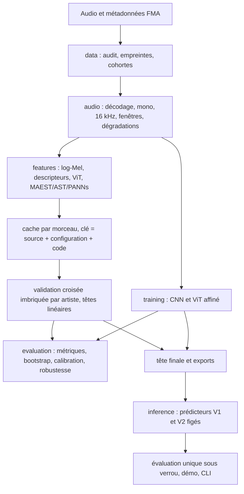

# Architecture du projet

Mis à jour : 11 novembre 2026 (état réel, V1 et V2). La version du 20 octobre décrivait une cible ; elle reste consultable dans l'historique Git.

## 1. Organisation

Un seul package Python, `music_genre`, dans `src/`, porte le code réutilisable. Les scripts de `scripts/` l'orchestrent ; la démo (`app/`), la CLI et les notebooks l'appellent. Il n'y a ni service, ni base de données, ni API web.

## 2. Modules

| Module | Contenu principal | Ne fait pas |
|---|---|---|
| `data` | Audit audio, empreintes Chromaprint, revue des doublons | Réétiqueter |
| `audio` | `processing` (décodage, segmentation ; épinglé V1), `degrade` (bruit, gain, MP3) | Normaliser selon le corpus |
| `features` | Log-Mel, HPSS, descripteurs, ViT d'images, `pretrained` (MAEST, AST, PANNs, ViT natif), cache par morceau | Ajuster quoi que ce soit sur des étiquettes |
| `models` | Modèle linéaire exportable, CNN V1 et CNN renforcé, ViT affiné, adaptateurs préentraînés | Télécharger des poids à l'import |
| `training` | Lots, prédiction par fenêtres, points de reprise du CNN | Utiliser le test |
| `evaluation` | Métriques, bootstrap apparié par artiste, `crossval`, `calibration`, `final_v2` (BCa, Holm, hors domaine) | Réentraîner |
| `inference` | `predict` (9 exports V1), `predict_v2` (MAEST + tête finale, CNN V2), démo | Lire le corpus d'entraînement |

## 3. Traçabilité

- **Caches** : la clé d'un cache réunit la source audio, la configuration et l'empreinte du code d'extraction. Un pointeur `data/features/latest_<nom>.json` désigne le cache en vigueur.
- **Exécutions** : chaque exécution écrit sa configuration résolue, les empreintes de ses entrées et ses prédictions (`runs/`, local).
- **Rapports** : les rapports versionnés (`reports/`) citent ces empreintes.
- **Verrous** :
  - le verrou V1 (29 octobre) fige la V1 ;
  - les verrous 1, 2 et 3 V2 (`reports/v2/`) figent, dans l'ordre, le protocole, l'audio audité, puis les systèmes, le code et l'environnement.
  - `scripts/evaluate_v2.py --final` refuse de tourner si un des 122 fichiers épinglés ou l'un des 171 paquets a changé.
- **Fichiers épinglés** : ils ne sont jamais modifiés. Les évolutions passent par de nouveaux modules, par exemple `predict_v2`, `degrade` ou `final_v2`.

## 4. Configuration et environnement

- `configs/` contient une configuration JSON par représentation et par étape V2 : `maest.json`, `cv_v2.json`, `degradations_v2.json`, `calibration_v2.json`, `evaluation_v2.json`, `protocol_v2.json`.
- L'ordre des classes est unique (`configs/labels.json`).
- `requirements/` fige les versions exactes. La procédure est décrite dans [REPRODUCTION.md](REPRODUCTION.md).

## 5. Commandes

- CLI : `python -m music_genre doctor` (sans ML) et `predict` (exports V1).
- Démo Gradio : `app/`.
- Chaîne V2 : voir [REPRODUCTION.md](REPRODUCTION.md), section 4.
