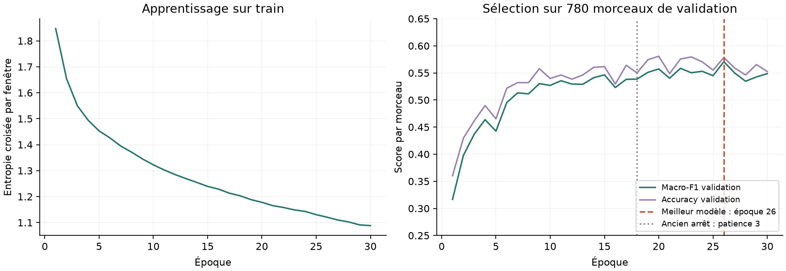

# Session utilisateur — résultats vérifiés

7 novembre 2026. **Session terminée ; contrôles réussis.** Le calcul lancé par
l’utilisateur a duré **48 min 52 s** entre le démarrage du superviseur et sa fin
(08:29–09:18, heure de Paris). Aucun nouvel entraînement lancé pendant la vérification.

## Résultats et arrêt

CNN depuis zéro, graine 42, 23 816 paramètres, trente époques maximum, patience cinq.
Le plafond de trente est atteint ; le modèle conservé est celui de **l’époque 26**.
Les quatre dernières époques n’améliorent pas sa macro-F1 : la patience de cinq
n’a donc pas déclenché l’arrêt. L’époque 30 obtient 0,5487, inférieure au meilleur
score ; l’export utilise bien les poids de l’époque 26.

| Partition | Morceaux | Corrects | Macro-F1 | Accuracy |
|---|---:|---:|---:|---:|
| Train | 6 299 | 3 987 | 0,6298 | 63,30 % |
| Validation | 780 | 451 | **0,5707** | **57,82 %** |

La perte d’apprentissage continue de diminuer tandis que la validation fluctue.
Cela ne démontre ni une convergence optimale ni l’intérêt de prolonger à nouveau.
Les scores train sont mesurés sur les données d’apprentissage ; le score validation
sert lui-même à choisir l’époque et ne constitue pas une estimation finale indépendante.

## Ce que change le budget plus long

| Expérience, graine 42 | Plafond / patience | Époques réalisées | Époque retenue | Macro-F1 validation |
|---|---|---:|---:|---:|
| CNN V1 prolongé | 20 / 3 | 18 | 15 | 0,5464 |
| Session utilisateur | 30 / 5 | 30 | 26 | 0,5707 |

Gain observé : **+0,02425**, soit **+2,42 points**. Les pertes train et toutes les
métriques validation des dix-huit premières époques sont identiques entre les deux
expériences ; seules les durées diffèrent. L’ancienne patience arrêtait le calcul
à 18, avant une amélioration à 19. La nouvelle recette atteint un meilleur score
à 26. Plafond et patience changent ensemble : ce n’est pas une ablation isolant
l’un des deux paramètres. Une seule graine est relancée ; aucune supériorité moyenne
ou statistique sur les trois graines V1 n’est démontrée.

Le candidat ViT bloc 6 + HPSS conserve une macro-F1 validation de 0,5975. Comparer
ce chiffre à 0,5707 reste descriptif : préentraînement, entrées et budgets diffèrent.
Le CNN utilisateur n’a pas été évalué sur test ; on ne le compare pas au score
test 0,5035 du ViT comme s’il s’agissait de la même partition.

## Genres et limites

Sur validation, Hip-Hop atteint une F1 de 0,7143 et International 0,7073.
Pop reste faible : **10 morceaux correctement classés sur 94**, F1 0,1370.
L’écart macro-F1 train–validation est de 0,0591 ; les erreurs restent importantes
malgré l’amélioration. Ni le gospel, ni le rejet d’un genre inconnu, ni des
probabilités calibrées ne sont couverts par ce modèle à huit classes FMA.

## Vérifications et preuves

[Contrôle détaillé](USER_SESSION_CHECK.json) : configuration et sources, empreintes
du cache et de l’index, cohortes exactes et artistes disjoints, probabilités finies,
classes, confusions et métriques par genre recalculées depuis le CSV. L’historique
et la patience sont rejoués ; checkpoint et export contiennent le même meilleur modèle.

L’inférence de l’export a été rejouée sur **21 237 fenêtres** train/validation.
L’agrégation par morceau et les métriques sont recalculées séparément du code
d’évaluation du projet. Écart maximal des probabilités validation : **0,0**.
Le modèle et la préparation des lots réutilisent le code de production ;
l’extraction audio n’a pas été répétée, les octets du cache ont été contrôlés.
Aucun audio test chargé. Le manifeste final et le rapport test V1 sont inchangés.

Run : [rapport brut](../runs/cnn_user-20261107T073012932719Z/report.json),
[prédictions](../runs/cnn_user-20261107T073012932719Z/validation_predictions.csv),
[suivi du processus](USER_TRAINING_JOB.json).
Contrôle ponctuel : `data/interim/verify_user_completion.py` ; empreinte conservée
dans le rapport de vérification. Les scores issus du petit essai de préparation
ne sont pas utilisés ici.

Cette expérience pédagogique postérieure à l’ouverture du test V1 complète le
projet sans modifier sa sélection initiale ni réutiliser le test pour l’ajuster.
Voir [la conclusion générale](../docs/CONCLUSION_PROJET.md).
